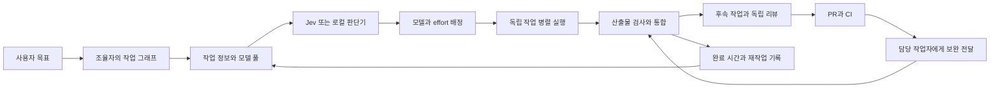

# SwitchBite 자동 탐색과 작업 배정 구현계획

작성일: 2026-10-27. 기준 버전: 0.7.0-workflow.1, 커밋 `f1fdb2c65cd4e8216b8a04a59f00a883a8976cb9`.

SwitchBite에 CLI·모델 자동 탐색, 작업 정보에 맞춘 배정, 실행 결과를 반영하는 배정 정책, PR·CI 보완 연결을 추가한다. 사용자는 기존 도구에 한 번 연결하고 목표를 전달한다. 조율자는 작업을 분해하고, SwitchBite는 사용 가능한 후보를 찾아 배정과 실행을 이어간다.

첫 배포는 판단 입력 보강, 모델 풀 자동 구성, Cursor·OpenCode 실행, 간단한 연결 경험까지 완성한다. 다음 배포에서 실행 실적을 배정에 반영하고 PR·CI 피드백을 연결한다. 구현 범위는 SwitchBite 플러그인과 전용 테스트 환경이다. 실행 코드는 Rust로 작성하며 StackBite 원본의 코드·설치·기존 세션은 유지한다.

## 1. 사용자가 경험할 흐름

사용자는 `switchbite codex` 또는 `switchbite claude`로 조율 도구를 연결한다. 판단기는 별도 설정에서 Jev 또는 로컬 판단기를 선택한다. 설치된 CLI, 해당 CLI가 제공하는 모델과 reasoning 설정은 SwitchBite가 탐색한다. CLI의 로그인 절차는 그 CLI가 제공하는 방식으로 진행한다.

조율자에게 목표를 전달하면 다음 흐름을 따른다.



기본 선호는 사용자가 정한 역할을 따른다. Codex는 조율·리뷰, Claude는 구현, Antigravity는 목업·작문에 우선 배정한다. Cursor·Grok은 균형형 후보로 둔다. OpenCode는 연결된 모델의 역량과 실행 실적에 따라 배정한다. 이 설정은 후보 간 선호이며, 사용자가 특정 모델·effort를 지정하면 그 지정을 우선한다.

조율자의 MCP 도구는 `switchbite_start`, `switchbite_next`, `switchbite_observe` 세 개를 유지한다. 사용자와 조율자가 실행기 종류나 내부 이벤트 형식을 직접 관리하는 일은 플러그인이 처리한다.

## 2. 현재 구현에서 이어 쓸 부분

| 구성 | 현재 상태 | 이번 변경 |
| --- | --- | --- |
| 작업 그래프 | 의존성, 병렬 실행, 경로·자원 예약, 검사·통합 구현 | 기존 스케줄러를 확장한다. |
| 판단 | Jev/Laya, 역할별 정책, 사용자 선호, 후보 필터 구현 | 실제 작업·모델 정보와 실행 실적을 입력에 연결한다. |
| 모델 풀 | 호출자가 최대 16개 후보를 제공 | 전체 탐색 목록과 작업별 판단 후보를 분리한다. |
| 실행기 | Claude Code·Codex 네이티브 실행 | 공통 실행기 경계 아래 Cursor·OpenCode와 ACP를 추가한다. |
| 연결 | 사용자 단위 연결과 프로젝트 workflow 연결이 공존 | 일반 연결 명령에서도 workflow를 바로 사용하도록 연결한다. |
| 평가 | 기록을 가져와 성공·시간·사용량·재작업 비교 | 실행 기록을 자동 수집하고 다음 배정에 반영한다. |
| 화면 | 작업 그래프, 모델 배정, 검사 근거, 실행 제어 | 현재 작업 추적, 배정 이유, 해결할 입력을 간결하게 표시한다. |

판단 입력을 만드는 `src/workflow/mod.rs`는 현재 task의 objective·requirements·context_refs를 사용한다. 별도로 저장된 acceptance·outputs는 자동으로 합쳐지지 않으며, 후보의 provider·model·effort도 설명문에 의존한다. 이 경로를 첫 번째로 수정한다.

## 3. 공통 데이터와 인터페이스

### 작업과 후보를 판단기에 전달하는 방법

내부 `RouteContextV1`에 작업 목표, 수락 조건, 산출물, 쓰기 범위, 통합된 선행 결과 요약, 작업 종류를 모은다. 후보에는 CLI 이름, 실제 모델 ID, effort, 사용 가능한 기능, 현재 실행 상태, 사용자 선호를 모은다. 실행 파일 경로와 인증 정보는 실행기에 남긴다.

첫 단계는 기존 routing API2를 유지한다. 작업 정보는 정해진 순서로 objective에, 모델 정보는 candidate description에 직렬화한다. 모든 항목은 이름과 출처를 구분해 전달한다. 동일한 입력은 동일한 문자열과 기존 snapshot 바인딩을 생성한다. 기존 API2 직접 호출은 기존 동작을 유지한다.

이 과정에서 수락 조건이나 사용자가 지정한 모델을 먼저 남긴다. 큰 선행 결과는 요약하고 원문 참조를 붙인다. 필수 정보가 입력 한도를 넘으면 작업 분해 액션을 반환한다. 입력을 자르는 과정에서 수락 조건을 조용히 없애지 않는다.

### 전체 탐색 목록과 작업별 후보

`CatalogSnapshot`은 설치된 CLI와 해당 CLI가 보고한 모델 목록을 보관한다. 각 항목에는 다음 정보를 둔다.

| 필드 | 용도 |
| --- | --- |
| harness, model_id, effort | 실제 실행 대상을 구분한다. |
| account_scope, execution_host | 계정과 실행 위치를 구분하는 비밀값 없는 참조다. |
| source, observed_at, cli_version | 탐색 정보의 출처와 갱신 시점을 기록한다. |
| capabilities | 세션 재개, 스트리밍, 모델 선택 등 확인한 기능을 기록한다. |
| readiness | ready, busy, rate_limited, sign_in_needed, unverified 상태를 구분한다. |
| reset_at, usage | CLI가 보고한 사용량과 초기화 시각을 기록한다. |

후보 ID는 harness·model·effort·계정 범위·실행 위치의 조합으로 안정적으로 만든다. 같은 모델의 다른 계정이나 실행 위치를 별도 자원으로 예약할 수 있게 한다.

자동 탐색은 새 workflow 입력의 `catalog` 선택으로 사용한다. `pool`을 명시하면 기존 수동 후보 모드를 사용한다. 두 입력을 동시에 주면 명시적 pool을 사용하며 자동 목록을 합쳐 넣지 않는다. 새로 연결한 조율자는 pool을 생략해 자동 탐색을 사용한다.

전체 목록은 catalog에 저장하고, 새 작업이 준비될 때 판단 후보를 최대 16개로 추린다. 필수 역량과 현재 실행 가능 상태를 먼저 적용하고, 사용자의 지정·선호, 관련 작업 실적, CLI별 후보 다양성을 반영한다. 실행 가능한 지정 후보는 반드시 남긴다. 후보가 많을 때는 여러 CLI와 노력 수준이 비교에 포함되도록 구성한다.

각 route 액션은 사용한 catalog revision과 `candidate_snapshot`을 보관한다. 배정 결과는 그 snapshot의 후보 ID로 확인한다. 선택된 후보의 실행 메타데이터는 해당 시도에 고정한다. catalog가 갱신되면 아직 시작하지 않은 배정을 다시 계산하고, 진행 중인 작업은 기존 대상을 유지한다.

### 실행기와 호스트의 경계

```rust
// 설계용 인터페이스. 실제 타입과 동기/비동기 방식은 W0에서 확정한다.
trait WorkerAdapter {
    fn describe(&self) -> Capabilities;
    fn discover(&self, scope: &DiscoveryScope) -> CatalogUpdate;
    fn start(&self, request: &ExecutionRequest) -> ExecutionHandle;
    fn poll(&self, handle: &ExecutionHandle) -> ExecutionUpdate;
    fn cancel(&self, handle: &ExecutionHandle) -> CancelResult;
}
```

세션 재개와 후속 메시지는 capability로 제공한다. Git 작업 공간, 경로 예약, 검사, 통합은 기존 호스트가 담당한다. 작업자 어댑터는 CLI·ACP 통신과 해당 세션의 완료 상태를 담당한다. 외부 오케스트레이터는 같은 의미의 prepare·launch·inspect·verify·integrate 결과를 기존 observe 경로로 전달한다.

## 4. 첫 배포 작업

### W0. 실행 계약과 호환성 확정

수정 대상은 `src/workflow_interface.rs`, workflow 입력 검증과 상태 저장 형식이다. catalog 선택, 후보 snapshot, adapter capability, 실행 결과의 공통 타입을 확정한다. 일반 연결의 서버 이름은 `switchbite`, 기존 프로젝트 설치는 `switchbite-stackbite`를 유지한다.

기존 작업 기록은 pool 모드로 읽는다. 새 기록에는 schema version을 넣고, 저장 시 전체 이력 변환을 요구하지 않는다. 수동 pool과 기존 세 MCP 도구의 호출 형식은 유지한다.

완료 조건은 기존 0.7 실행 기록을 읽어 상태를 확인할 수 있고, 기존 pool 요청과 새 catalog 요청이 각각 실행 가능한 상태로 생성되는 것이다.

### W1. 판단 입력 보강

`src/workflow/mod.rs`의 route 생성부를 `src/route_context.rs`로 분리한다. 수락 조건·산출물·선행 결과와 실제 모델·effort를 결정적으로 직렬화한다. 사용자 선호는 구조화한 설정에서 읽고 기존 preferences 입력으로 투영한다.

확인할 핵심 사례는 같은 설명의 후보라도 실제 모델·effort가 판단기에 구분되어 전달되는지, 수락 조건을 objective에 중복 작성하지 않아도 전달되는지, 긴 문맥에서 필수 조건이 보존되는지다. 이 검사는 판단 입력과 배정 결과를 구분해 확인한다.

### W2. CLI와 모델 자동 탐색

`src/catalog/`에 공통 저장소와 CLI별 probe를 만든다. Claude·Codex부터 연결하고 Cursor·OpenCode를 같은 형식으로 추가한다. 공식 모델 조회나 구조화된 세션 정보가 있는 경로를 우선 사용한다. 모델 조회를 제공하지 않는 버전은 사용자가 이미 설정한 기본 모델과 확인한 실행 옵션을 표시한다.

탐색은 읽기 중심으로 동작한다. CLI의 설치·버전·로그인 상태 조회, 모델 목록과 사용량 조회를 구분한다. CLI가 지원 여부를 알리지 않는 항목은 unverified로 남기고 최초 실행 결과로 갱신한다. 모델 이름을 실행 파일 이름만으로 만들어내지 않는다.

초기 캐시 값은 모델 목록 24시간, 실행 가능 상태 60초로 둔다. CLI 버전·계정 범위가 바뀌거나 실행 중 모델 오류·rate limit을 받으면 관련 항목을 즉시 갱신한다. `switchbite models`는 조회와 수동 새로고침을 제공하며, 일반 실행은 캐시와 자동 갱신을 사용한다.

완료 조건은 새 프로젝트에서 pool JSON 작성 없이 설치된 CLI와 확인된 모델을 사용해 실행을 시작하는 것이다. 모델 목록의 출처와 탐색 실패 이유는 상세 조회에서 확인할 수 있게 한다.

### W3. 공통 실행기 분리

`src/adapters/mod.rs`에서 provider 분기와 CLI 스트림 해석을 `src/adapters/workers/`로 옮긴다. Claude·Codex 동작을 먼저 동일하게 보존하고, Windows Job Object와 기존 실행 식별자·완료 기록을 공통 경로에 남긴다.

기존 병렬 실행, 취소, 중단 후 재연결, 검사 실패 후 새 시도, 통합 결과 확인 테스트가 통과하면 분리를 완료한다. 실행기 분리를 위해 Git·스케줄러를 다시 작성하지 않는다.

### W4. Cursor 실행기

Vibe Kanban의 Cursor 실행·모델 선택·로그 해석 부분을 참고해 필요한 Rust 코드를 추출한다. 설치된 Cursor Agent 버전의 구조화 출력과 모델 인자에 맞춰 실행하고, 실제 제공되는 reasoning 옵션만 catalog에 반영한다.

완료 조건은 Windows 전용 프로젝트에서 Cursor가 파일을 작성하고, 지정한 검사와 통합을 거쳐 의존 작업이 시작되는 것이다. 실패한 종료, 도구 오류 후 정상 완료, 취소도 같은 실행 계약으로 처리한다.

### W5. OpenCode 실행기

OpenCode의 모델 목록과 세션 API를 사용해 provider/model 조합을 탐색한다. 필요할 때 실행한 로컬 서버는 해당 실행기가 수명을 관리한다. 사용자가 이미 연결한 서버를 쓸 때는 그 연결 정보를 보존한다.

완료 조건은 OpenCode가 보고한 모델을 선택해 작업을 실행하고 결과를 통합하는 것이다. Claude·Codex·Cursor·OpenCode가 섞인 그래프에서도 같은 상태·검사·통합 흐름을 사용한다.

### W6. 한 번 연결하는 경험

`src/connect.rs`, `src/main.rs`, MCP 서버의 workspace 선택을 수정한다. 일반 `switchbite codex`·`switchbite claude` 연결이 workflow 서버를 제공하도록 연결한다. 다른 CLI의 MCP 연결도 같은 프로필을 사용하되 실제 클라이언트 지원 범위에 맞춰 설정한다.

프로젝트 설치는 기존 explicit workspace 바인딩을 유지한다. 사용자 단위 연결은 start 요청의 workspace로 실행 저장소를 선택하고, run ID와 저장 위치의 작은 인덱스를 유지한다. next·observe는 그 인덱스로 실행을 찾는다. 프로젝트 A와 B의 실행을 섞지 않으며 현재 프로세스의 cwd를 모든 클라이언트의 프로젝트 위치로 가정하지 않는다.

SwitchBite가 관리하는 이전 연결만 새 프로필로 갱신한다. 다른 MCP 설정과 사용자가 지정한 실행 명령은 보존한다. 판단기 선택과 인증값은 기존 설정을 사용한다.

완료 조건은 연결 명령 실행 후 새 조율 세션에서 목표·workspace만 전달해 자동 pool 실행을 시작하는 것이다. 기존 수동 pool과 프로젝트 연결도 계속 사용할 수 있어야 한다.

## 5. 공통 연결과 진행 화면

### W7. ACP와 Herdr 연결

ACP Rust SDK의 stable v1을 이용해 `src/adapters/workers/acp.rs`를 추가한다. 연결 시 capability와 모델 설정을 확인하고 세션 시작·업데이트·취소를 공통 실행 결과로 변환한다. 네이티브 CLI 어댑터와 ACP가 모두 있으면 사용자 설정과 확인한 기능으로 실행 경로를 선택하고, 같은 실행을 두 경로로 시작하지 않는다.

Herdr 연결은 `herdr-plugin.toml`의 action·event hook·pane entrypoint와 로컬 API를 사용한다. SwitchBite 실행 파일을 호출하는 얇은 연결을 제공한다. 호스트별 상태 이름은 공통 이벤트로 변환하고, StackBite는 기존 coordinator MCP 연결을 사용한다.

첫 검증은 ACP 테스트 에이전트와 실제 ACP 지원 작업자 하나, 별도 Herdr 테스트 세션으로 한다. Grok·Antigravity 연결은 실제 설치 버전과 플랫폼에서 확인한 프로토콜로 추가한다. 조사한 Orca의 Antigravity ACP 패키지 경로는 macOS·Linux 자산이므로 Windows 연결은 설치된 제품의 제공 경로를 확인해 구현한다.

### W8. 이벤트와 작업 화면

기존 영속 이벤트 위에 cursor 기반 구독을 추가한다. SSE로 상태 변경을 화면에 전달하고, 재접속 시 snapshot과 cursor로 이어 받는다. 기존 status 조회는 CLI와 MCP에서 계속 사용한다.

화면 첫 줄에는 현재 실행 작업, 담당 CLI·모델, 다음 의존 작업을 표시한다. 배정 이유는 "구현 선호 + 사용 가능", "같은 종류 작업의 재작업이 적음"처럼 관측 정보와 설정을 근거로 짧게 쓴다. 정확한 모델·effort와 검사 상세는 펼쳐 볼 수 있게 한다.

실행 중인 노드를 자동으로 따라가되 사용자가 다른 작업을 선택하면 그 선택을 유지한다. 필요한 입력은 해당 작업 카드에 해결 행동과 함께 표시한다. 화면을 닫거나 다시 열어도 실행을 중복 시작하지 않는다.

## 6. 실행 결과를 다음 배정에 반영

### W9. 실행 결과 자동 수집

`src/outcomes/`에서 task·candidate·policy·catalog revision과 실행 결과를 연결한다. 실행 시간, 대기 시간, 재작업 횟수, 검사 결과, 통합 결과를 기존 기록에서 수집한다. 사용량은 CLI가 보고한 단위와 출처를 함께 저장한다. 월 구독 사용량을 API 달러 비용으로 환산하지 않는다.

모델 완료, 파일 존재, 명령 검사, 사람의 수락은 다른 관측으로 기록한다. 예를 들어 파일 존재만 확인한 작업을 내용 정확도 학습의 정답으로 사용하지 않는다. 이 구분은 기록과 정책 계산에서 처리하며 사용자에게 매번 평가 양식을 요구하지 않는다.

기존 `src/evaluation.rs`의 비교 형식으로 내보내기를 제공한다. 초기 저장은 프로젝트의 append-only JSONL과 재생성 가능한 집계 파일로 구현한다. 수집을 위해 별도 데이터베이스 서비스를 실행하지 않는다.

### W10. 실적을 반영하는 배정

처음에는 사용자 역할 선호와 Jev 판단을 사용한다. 관측이 쌓이면 작업 종류·저장소·모델·effort별 성공, 완료 시간, 재작업을 집계하고 표본 수를 함께 사용한다. 적은 표본의 우연한 성공이 전체 배정을 바꾸지 않도록 사용자 선호를 초기값으로 둔다.

초기 정책은 기존 Jev·선호 점수를 기준으로 최고 점수와 0.05 이내인 후보를 비교한다. 같은 작업 종류의 비교 가능한 관측이 각 후보에 8개 이상 있으면 평활한 검사 통과율, 재작업 횟수, 완료 시간 순으로 선택한다. 그 외에는 사용자 선호와 기존 점수를 사용한다. 0.05와 8개는 첫 배포의 조정 가능한 설정값이다. 검사 종류가 다른 관측은 별도 집계한다.

처음에는 실적 보정 전후의 선택을 함께 기록하는 shadow 모드로 시작한다. 비교 묶음에서 기존 정책이 통과한 수락 조건을 새 정책도 통과하고, 전체 완료 시간 또는 재작업이 줄어든 정책을 기본값으로 승격한다. 실패 사례가 생기면 바뀐 배정과 관련 기록을 확인해 해당 정책을 수정한다. 정책 버전과 직전 버전을 보존해 즉시 되돌릴 수 있게 한다.

특정 모델·effort 지정은 고정한다. 자동 배정 작업은 사용자가 허용한 다른 후보로 이어갈 수 있다. provider 오류와 모델 수행 실패를 구분하며, 이미 시작한 실행은 기존 실행 식별자로 확인한 뒤 다음 시도를 결정한다.

여러 준비 작업이 같은 자원을 요구하면 실행 가능한 후보가 적은 작업부터 빈 자원을 배정한다. 다른 작업은 남은 후보로 배정하고, 후보가 모두 실행 중이면 완료 이벤트 후 다시 배정한다. 갱신 대상은 아직 시작하지 않은 작업이다.

## 7. PR과 CI에서 보완 작업으로 연결

### W11. 담당 작업자에게 피드백 전달

`src/integrations/github.rs`에서 GitHub PR의 검사 결과와 리뷰 의견을 읽고 기존 task·branch·execution과 연결한다. CI 실패 메시지에는 실패한 검사와 로그 위치를, 리뷰 메시지에는 파일·줄·요청 내용을 담는다. Orchestrator.inc의 담당 세션 연결과 중복 전달 방식을 참고한다.

같은 실패나 의견은 한 번 전달하고, 새 커밋의 새 결과는 다시 처리한다. 원래 작업자가 후속 세션을 지원하면 그 세션으로 전달하고, 세션이 끝났으면 같은 branch·변경·근거를 포함한 보완 작업을 만든다. 독립 리뷰와 통합 검사는 기존 흐름을 사용한다.

사용자가 설정한 PR 작성·merge 정책에 따라 동작한다. 로컬 완료를 원하는 프로젝트는 PR 단계를 생략한다. 체크가 실패한 작업만 보완하고, 관련 없는 준비 작업은 계속 진행한다.

## 8. 구현 순서와 병렬 작업

W0의 공통 타입과 소유 파일을 확정한 뒤 세 작업자를 사용한다. 하위 구현 작업자는 사용자 지정 Codex GPT-6.1-Terra high를 사용하고, 조율자는 통합·독립 검수·실제 CLI 확인을 담당한다.

| 묶음 | 작업자 A | 작업자 B | 작업자 C | 통합 조건 |
| --- | --- | --- | --- | --- |
| 첫 연결 | W1 판단 입력 | W2 catalog | W3 실행기 분리 | W0 타입과 기존 동작 유지 |
| 첫 배포 | 후보 추리기·W6 연결 | W4 Cursor | W5 OpenCode | 자동 pool과 혼합 CLI 그래프 완료 |
| 호스트 연결 | W7 ACP·Herdr | W8 이벤트·화면 | W9 결과 수집 | 공통 결과·이벤트 계약 |
| 배정 개선 | W10 실적 반영 | W11 PR·CI | 혼합 작업 실제 검증 | 기록 형식과 실행기 후속 세션 지원 |

W6의 `main.rs`·MCP 진입점은 조율자 또는 지정한 한 작업자가 소유한다. 실행기 파일은 provider별로 나누고 공통 process·Git 코드는 단일 소유자로 둔다. 각 작업자는 명시한 기준 커밋의 별도 worktree에서 작업하고, 완료 커밋과 검사 결과를 보고한다.

Cargo 출력 경로를 공유하는 현재 환경에서는 build·test를 한 번에 하나씩 실행한다. 다른 작업자는 그동안 구현과 소스 검토를 진행한다. 다음 작업은 계약이 준비된 항목부터 미리 배정하되 같은 파일을 동시에 수정하지 않는다.

## 9. 완료를 확인할 사례

| 사례 | 확인할 결과 |
| --- | --- |
| 새 프로젝트 연결 | pool JSON 없이 탐색한 후보로 첫 작업을 시작한다. |
| 다른 두 프로젝트 | 각 workspace의 기록·작업 공간·run ID가 올바르게 연결된다. |
| 같은 모델의 다른 effort | 판단 입력과 실제 실행 인자에 지정한 값이 전달된다. |
| 여러 CLI의 많은 모델 | 전체 catalog를 보존하고 작업마다 적합한 후보를 추린다. |
| Claude·Codex·Cursor·OpenCode 혼합 | 독립 작업 병렬 실행 후 검사·통합을 거쳐 리뷰가 시작된다. |
| 선호 CLI의 rate limit | 허용한 자동 배정 작업은 다른 후보를 선택하고 해당 자원은 초기화 시각에 갱신한다. |
| 지정 모델 사용 불가 | 정확한 원인과 지정 변경 또는 연결 해결 행동을 표시한다. |
| 프로세스 종료와 재연결 | 기존 실행·산출물·통합 기록을 확인해 이어간다. |
| 새 CI 실패와 리뷰 의견 | 담당 작업자에게 전달되고 같은 이벤트가 중복 보완을 만들지 않는다. |
| 화면 재접속 | 현재 그래프와 선택한 작업을 복원한다. |

배정 비교용 초기 작업 묶음은 구현·리뷰·목업·작문·조사·간단 수정 각 4개, 총 24개로 구성한다. 같은 시작 커밋과 같은 수락 조건에서 사용자 역할 고정 배정, Jev 배정, 실적 보정 배정을 비교한다. 이는 첫 정책의 오류와 차이를 찾는 개발용 묶음이며, 실제 프로젝트 결과가 쌓이면 해당 작업 유형을 추가한다.

측정값은 완료된 수락 조건, 목표 전달부터 검사·통합 완료까지의 시간, 실행 시간과 대기 시간, 재작업, 사용자에게 요청한 입력 횟수다. 사용량은 같은 단위끼리 비교한다. 정책별 표본과 누락을 함께 보여주고, 정책이 바꾼 작업과 바꾸지 않은 작업을 구분한다.

첫 배포는 연결 명령부터 혼합 CLI 그래프 완료까지를 실제 설치된 CLI로 확인하고, 기존 Claude·Codex·수동 pool 경로와 함께 배포한다. 기록 재생·가짜 provider 테스트는 중단·취소·중복 통합처럼 재현이 필요한 동작에 사용한다. 외부 API 오류나 CLI 버전 차이는 해당 어댑터의 수정 항목으로 처리한다.

## 10. 사용자 흐름을 기준으로 한 기능 선택

| 상황 | 기본 동작 |
| --- | --- |
| 두 후보가 비슷함 | 사용자 선호와 현재 자원 상태로 선택하고 이유를 표시한다. |
| 문맥이 부족함 | 프로젝트 파일과 통합된 선행 결과를 먼저 수집한다. |
| 비용 정보를 얻지 못함 | 일반 배정은 확인한 적합도·시간·사용량을 사용한다. 사용자가 비용 상한을 지정한 작업은 비용을 확인할 수 있고 상한을 만족하는 후보에서 배정한다. |
| 모델이 불확실한 판단을 냄 | 작업·후보 정보를 보강해 판단한다. 자동 작업은 허용 후보 안에서 실행하고 설정된 검사로 결과를 확인한다. |
| 실행 상태가 끊김 | 기존 실행 식별자와 호스트 기록을 조회해 계속 추적한다. |
| 사용자 결정이 필요함 | 해당 작업 카드에 필요한 입력과 실행할 행동을 한 번에 표시한다. |
| 일부 작업에 보완이 필요함 | 그 작업과 의존 작업을 조정하고 독립 작업은 계속한다. |

작업 완료를 바꾸지 않는 추가 승인 화면, 같은 실패를 설명하는 중복 보고, 문구만 바꾸는 반복 검수는 개발 항목으로 늘리지 않는다. 중복 실행 방지·경로 예약·실행 취소·검사 후 통합은 실제 산출물과 실행을 관리하는 기존 기능으로 유지한다. 각 새 작업은 연결에 필요한 입력, 수동 선택, 대기, 재작업 중 무엇을 줄이는지 설명하고 완료 사례와 연결한다.

## 11. 재사용할 코드와 출처

| 출처 | 적용 범위 | 방식 |
| --- | --- | --- |
| [Vibe Kanban executors](https://github.com/BloopAI/vibe-kanban/tree/a019cebf0693f787ef0f8dc2bb8d37edd35527ac/crates/executors/src) | 실행기 trait, Cursor·OpenCode, 모델 탐색과 로그 | Apache-2.0 코드의 필요한 부분을 추출한다. |
| [ACP Rust SDK](https://github.com/agentclientprotocol/rust-sdk/tree/644377ad2654415c76c979c795d6c568e17a6d62) | 공통 세션 통신·MCP 연결 | SDK를 감싸는 작은 어댑터를 작성한다. |
| [Orca](https://github.com/stablyai/orca/tree/4c66f91c84f79676d3f0a2d12fd614e98ffda8d7/src/main) | CLI별 연결, 모델 목록, 사용량 | MIT 코드의 필요한 프로토콜과 동작을 Rust에 이식한다. |
| [Herdr](https://github.com/herdrdev/herdr/tree/2713feb56e9c9db33992db0a262c68f7426d46dd) | 플러그인 manifest, 상태 이벤트·구독 | Apache-2.0 구현을 참고하고 호스트 API로 연결한다. |
| [Orchestrator.inc reactions](https://github.com/OrchestratorInc/agent-orchestrator/blob/c7a99e1ad83c0ea9bfc84e35f679fa2a08e6169f/backend/internal/lifecycle/reactions.go) | CI·리뷰를 담당 세션에 전달 | Apache-2.0 동작과 데이터 계약을 Rust로 이식한다. |
| [TensorZero](https://github.com/tensorzero/tensorzero/tree/62eb8f63e8ec62018d70420dbf1a8c5d1c026315) | 관측 결과·피드백과 정책 비교 | 기존 evaluator에 필요한 기록·평가 구조를 적용한다. |
| [omo-herdr-dag](https://github.com/jc01rho/omo-herdr-dag/tree/69f90a23bd3e01c39fbf092d56fa7ce984bd478a) | 현재 작업 추적·접기·선택 보존 | MIT 구현의 상호작용을 Rust 화면에 적용한다. |

코드를 가져오는 커밋에서 파일별 라이선스와 의존성을 확인하고, 가져온 파일과 변경 내용을 NOTICE 및 짧은 출처 기록에 남긴다. OmO의 SUL 코드와 Paradev의 ELv2 코드는 이번 상용 코드 이식 대상에서 제외하고 사용자 흐름을 참고한다.

## 12. 판단 모델 추가 실험

Jev와 Laya 선택을 유지하면서 vLLM Semantic Router의 [Decision 3.0 d3](https://huggingface.co/vllm-sr/d3/blob/v3.1.0/README.md)를 별도 판단기 후보로 비교한다. 동일한 RouteContext와 후보 snapshot을 사용해 선택 결과, 판단 지연, 실제 작업 결과를 기록한다. SwitchBite는 Rust HTTP 어댑터로 연결하며 모델 서비스는 외부 실행 경계에 둔다.

이 실험은 W1과 W9의 데이터를 이용해 병렬로 진행한다. 첫 연결·실행기 배포는 현재 판단기로 완료하고, 새 판단기의 요청·응답 형식과 실제 작업 배정 결과를 확인하면 선택지로 추가한다.

## 13. 첫 구현 착수 순서

1. W0 타입·workspace·후보 snapshot 계약을 확정한다.
2. W1·W2·W3를 독립 worktree에 병렬 배정한다.
3. 기존 Claude·Codex 작업으로 입력 보강과 실행기 분리를 통합 확인한다.
4. W4·W5와 자동 후보 추리기·W6를 병렬 진행한다.
5. 새 연결에서 혼합 CLI 프로젝트를 완료하고 첫 설치 패키지를 배포한다.
6. W7·W8·W9를 병렬 진행한 뒤 W10·W11을 연결한다.

첫 구현의 사용자 결과는 명확하다. 연결 명령 한 번으로 실제 모델 풀이 구성되고, 조율자가 나눈 작업이 적절한 CLI와 effort로 배정되어 검사·통합까지 진행된다.
